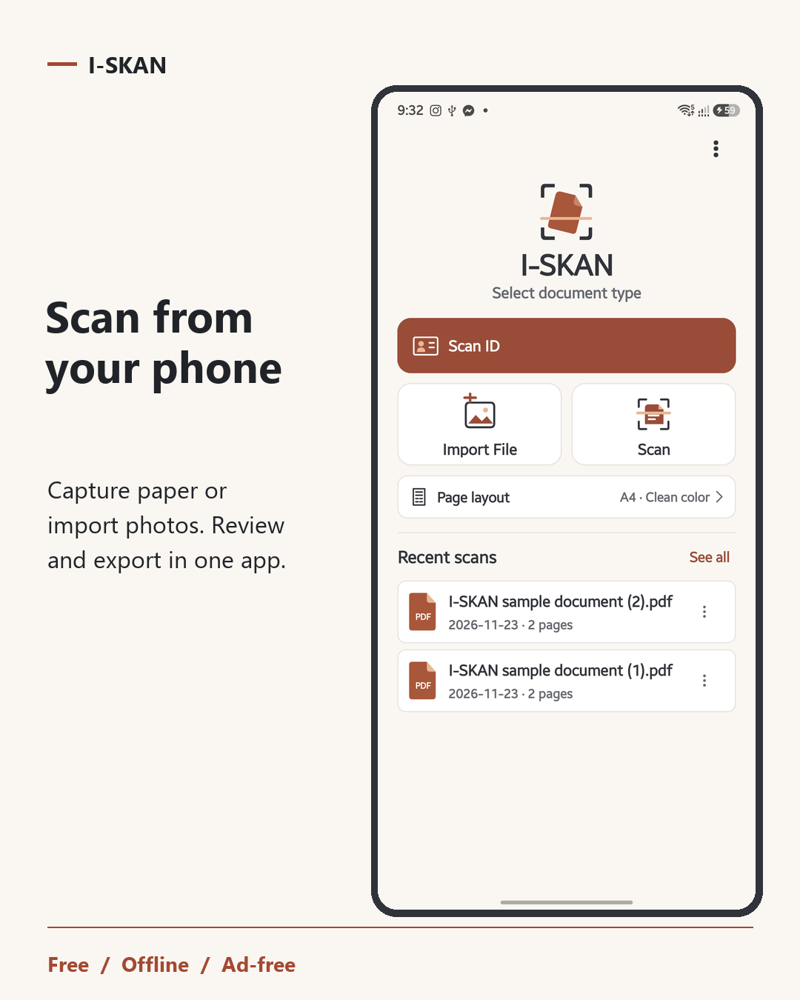
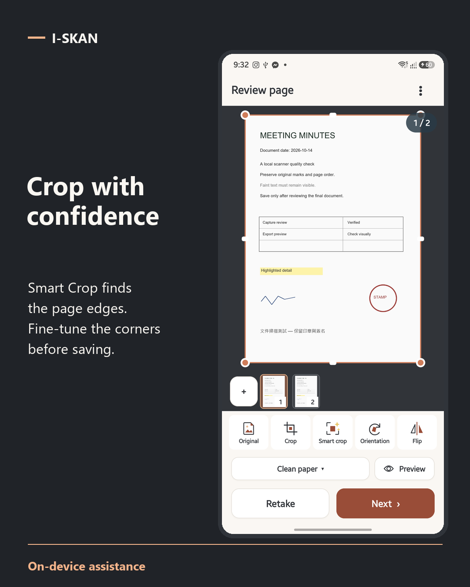
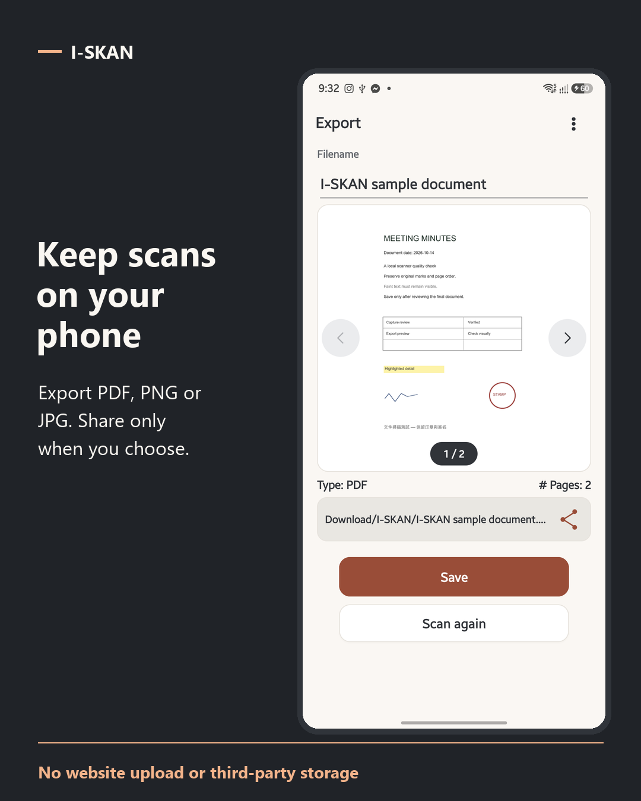

<p align="center"></p>
<h1 align="center">I-SKAN</h1>
<p align="center">
  
  
  
</p>
<p align="center">A free, offline document scanner for Android</p>

I-SKAN helps you turn paper documents into digital copies for submission using your phone. Scan an ID, signed form, or receipt without a printer or a website upload.

[Android setup and build guide](android/README.md) · [Desktop scanner guide](DESKTOP.md) · [MIT license](LICENSE)

<p align="center">
  <a href="docs/media/01-pocket-scanner.png"></a>
  <a href="docs/media/02-smart-capture.png"></a>
  <a href="docs/media/05-private-export.png"></a>
</p>

## What you can do

- Scan documents or import multiple photos from your gallery.
- Use capture guidance and Smart Crop, then adjust corners and straighten the page with a curved ruler.
- Clean up shadows, adjust the paper tone, and preview the result.
- Put the front and back of an ID on one A4 page.
- Get editable title suggestions from on-device text recognition.
- Export PDF, PNG, or JPG. PDF can include selectable text where recognition succeeds.

## Run the Android app

I-SKAN supports Android 10 and newer. Build the APK below, then install the variant that matches your phone. Most physical Android phones use arm64.

## Run from source

Open the [android](android) folder in Android Studio, or run the build script from the repository root with the Android SDK and Android Studio JDK installed.

```powershell
.\build-android.ps1 -Check
```

The script places the APKs in `output/android/`. The separate Windows browser scanner is documented in [DESKTOP.md](DESKTOP.md).

## Your data

The Android app works offline and has no ads. It processes scans on your phone and saves exports under `Download/I-SKAN/`. You choose when to share a saved file.

## Development and packaging

See the [Android guide](android/README.md) for tests and the separate preview build. See [validation notes](VALIDATION.md) for the desktop implementation.

## License and credits

I-SKAN source code is licensed under the [MIT License](LICENSE). Third-party dependencies, fonts, and OCR models retain their own licenses. See [Android third-party notices](android/THIRD_PARTY_NOTICES.md) and the [desktop guide](DESKTOP.md#dependencies-and-licenses).

Developed by Christian Cabahug.
